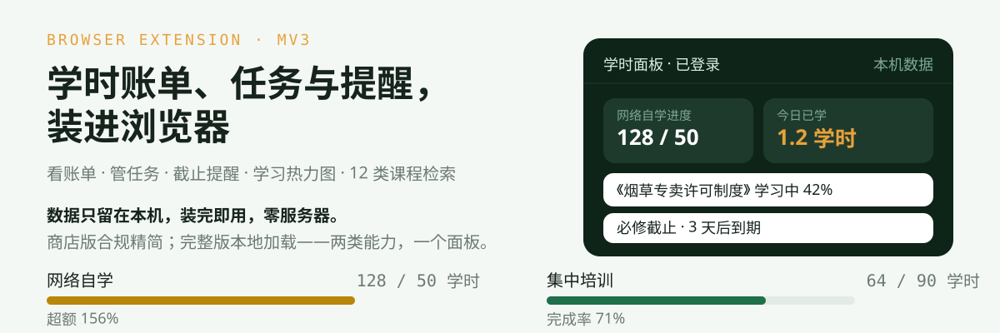
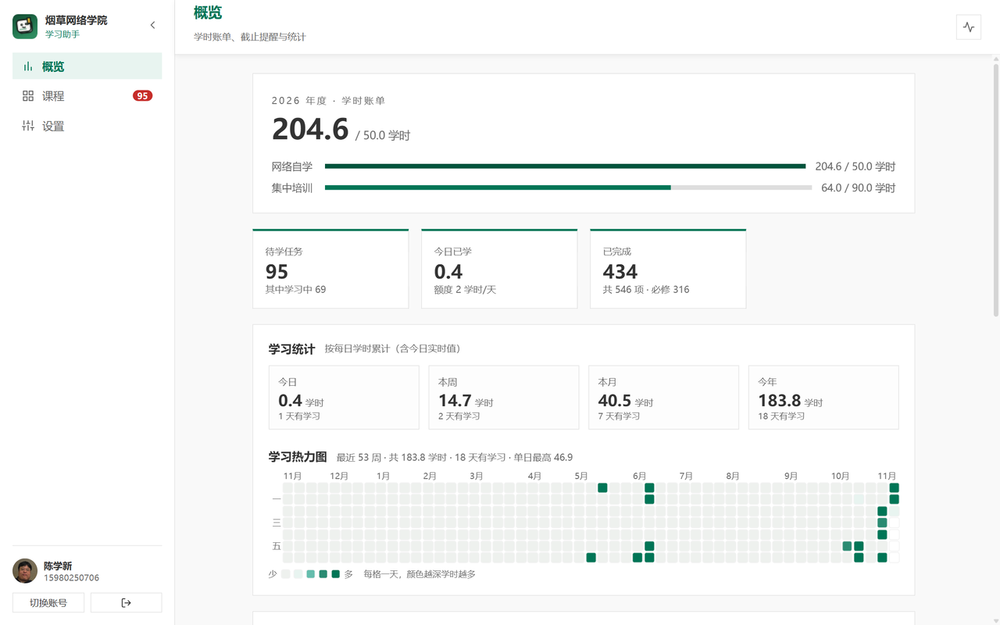
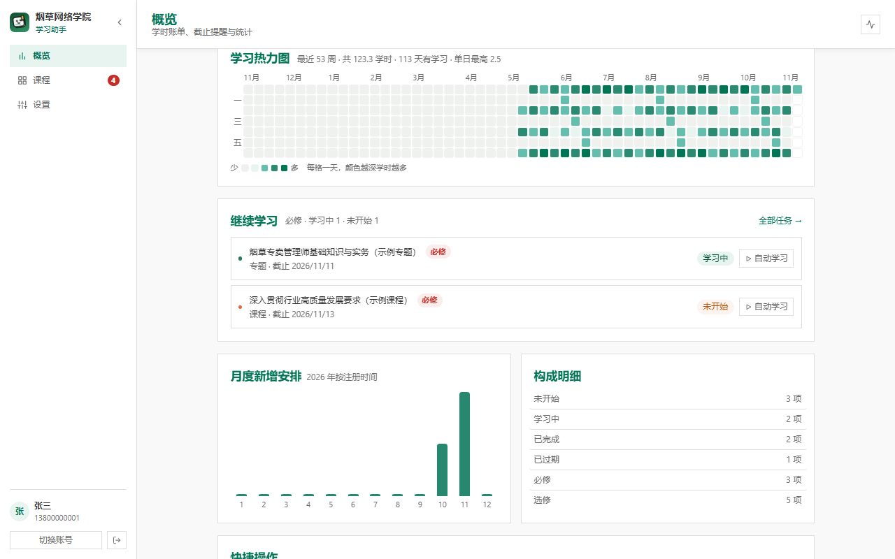
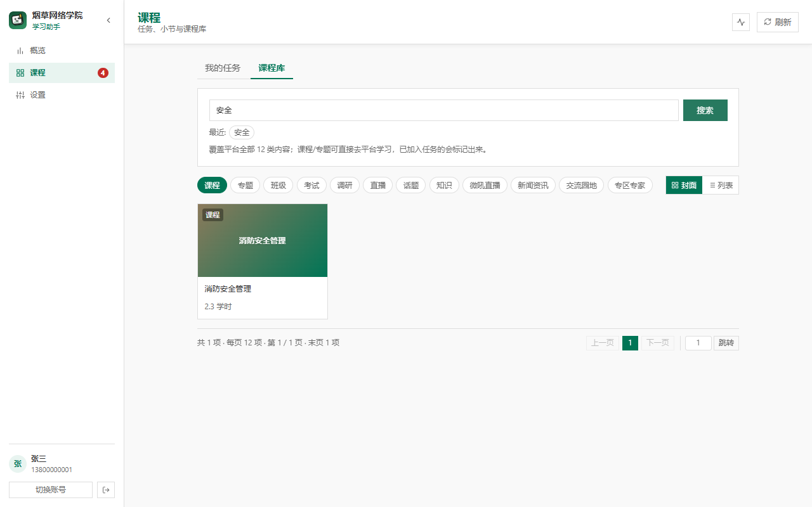
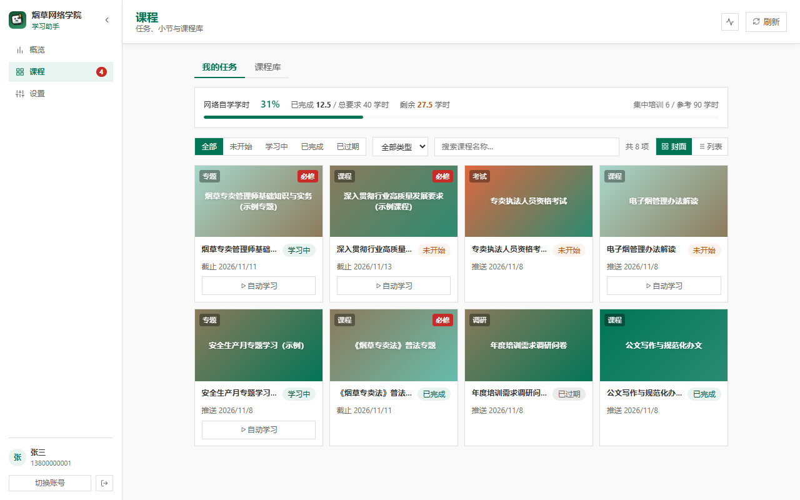
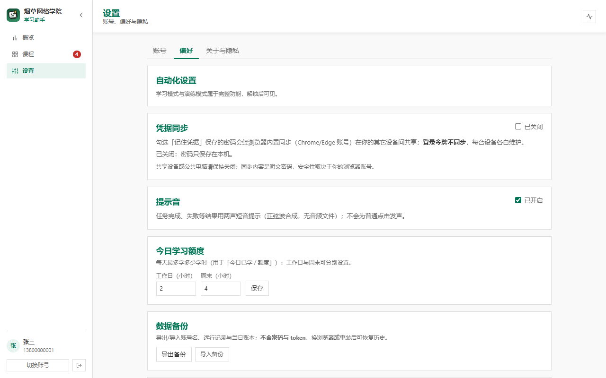
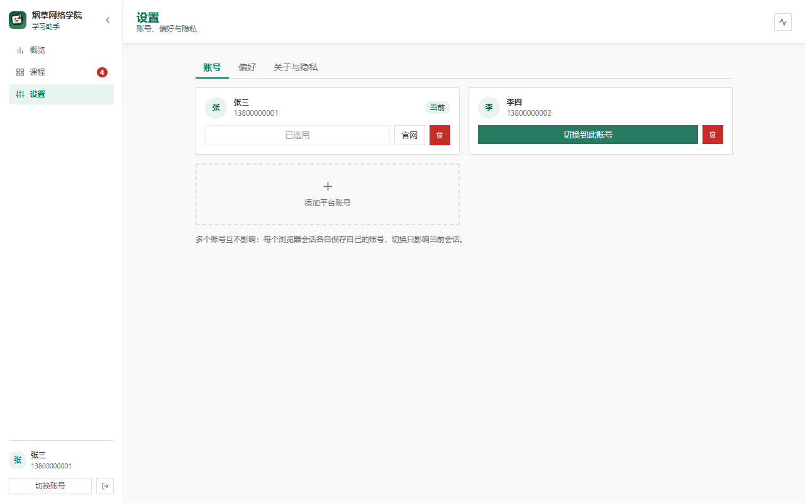
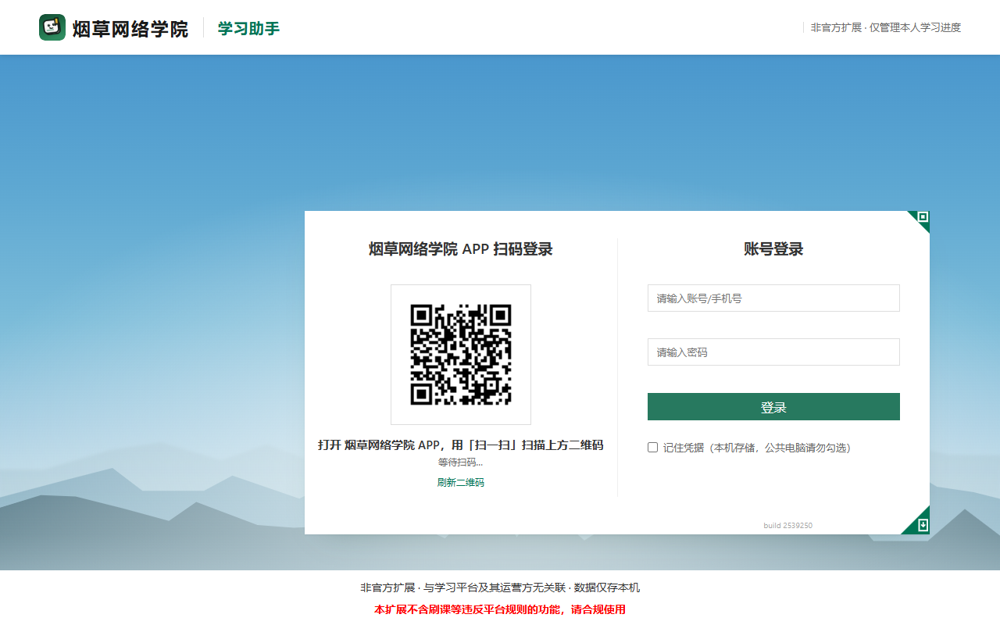
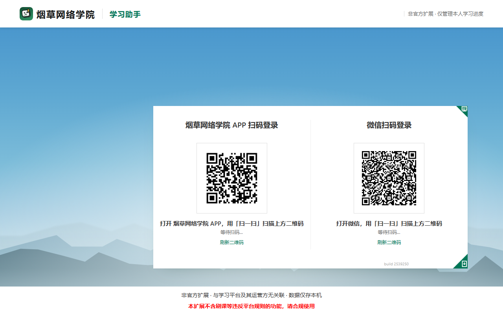
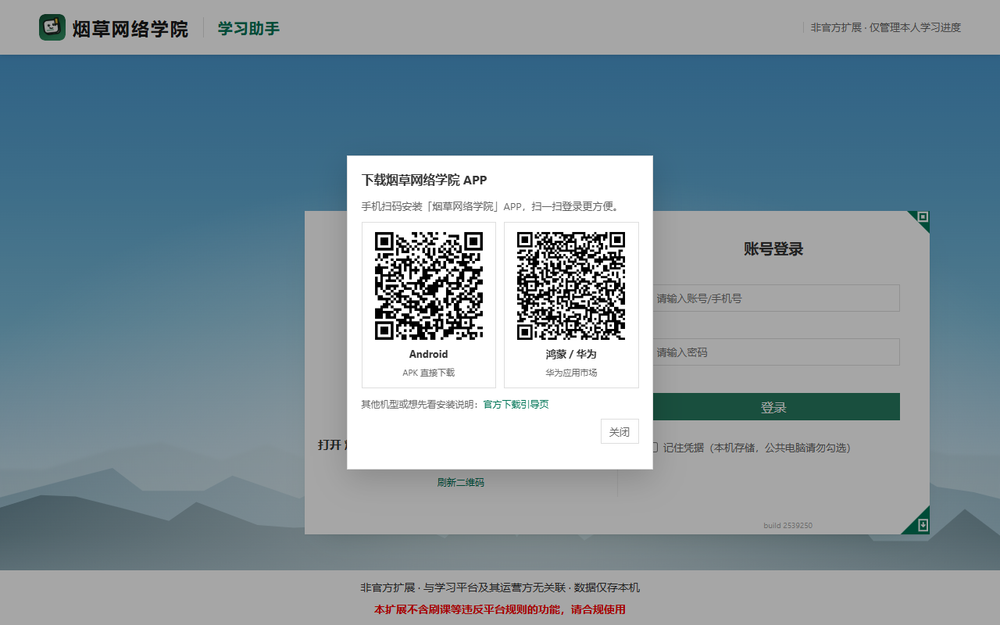

# tobacco-mooc-study (ext)

<p align="center">
  
</p>

<p align="center">
  <a href="https://chromewebstore.google.com/detail/%E7%83%9F%E8%8D%89%E7%BD%91%E7%BB%9C%E5%AD%A6%E9%99%A2%E5%AD%A6%E4%B9%A0%E5%8A%A9%E6%89%8B/mpaogiihgbgjjednnjimmpobijpoilbc"></a>
  <a href="https://chromewebstore.google.com/detail/%E7%83%9F%E8%8D%89%E7%BD%91%E7%BB%9C%E5%AD%A6%E9%99%A2%E5%AD%A6%E4%B9%A0%E5%8A%A9%E6%89%8B/mpaogiihgbgjjednnjimmpobijpoilbc"></a>
  <a href="https://chromewebstore.google.com/detail/%E7%83%9F%E8%8D%89%E7%BD%91%E7%BB%9C%E5%AD%A6%E9%99%A2%E5%AD%A6%E4%B9%A0%E5%8A%A9%E6%89%8B/mpaogiihgbgjjednnjimmpobijpoilbc"></a>
  
  
</p>

<p align="center">
  <a href="#实拍">实拍</a> ·
  <a href="#功能亮点">功能</a> ·
  <a href="#安装">安装</a> ·
  <a href="#隐私与安全">隐私与安全</a> ·
  <a href="#免责声明">免责声明</a>
</p>

---

## 实拍

**学习首页**：年度学时账单、今日已学、必修临近截止、继续学习与学习统计。

<p align="center">
  
</p>

**学习热力图与课程库**：26 周每日学时；平台全部 12 类内容检索，封面/列表双视图。

<p align="center">
  
  
</p>

**课程封面视图与设置**：

<p align="center">
  
  
  
</p>

**登录三通道**：账号密码 / APP 扫码 / 微信扫码；授权后，官网页面加载时令牌自动捕获，可**无感导入**登录态。

<p align="center">
  
  
  
</p>

---

## 功能亮点

- **学时账单**：网络自学 / 集中培训分开核算，进度条与差额一目了然——网课补不上面授缺口，它替你把账分开算
- **任务与提醒**：必修临近截止 7 天清单；每任务显示已学学时；页头学时进度条
- **学习热力图**：近 26 周每日学时（GitHub 贡献图风格），数据来自平台学习档案
- **课程库**：平台全部 12 类内容检索（课程 / 专题 / 班级 / 考试 / 调研 / 直播 / 话题 / 知识 / 微吼直播 / 新闻资讯 / 交流园地 / 专区专家），封面/列表双视图，已加入任务标记
- **登录**：三通道（账号密码 / APP 扫码 / 微信扫码，对齐官网设计）+ 官网登录态**无感导入**（授权后，官网页面加载时令牌自动捕获，打开扩展即已登录）
- **无人值守看课**（完整版）：在学院官网真实页面上自动点击播放、自动下一节/下一课/下一门队列推进——**零上报、零伪造**，进度由平台自己的播放器如实记录，学时是真材实料的真实学时；含鼠标移动模拟（防平台待机检测）、平台弹窗自动处理
- **运行日志**：运行记录与实时日志联动，点任意记录看该次运行的完整日志（完整版）
- **多标签页状态同步**；全部数据只存本机，零服务器

---

## 安装

### 方式一：Chrome Web Store（推荐）

**[→ 烟草网络学院学习助手 · Chrome Web Store](https://chromewebstore.google.com/detail/%E7%83%9F%E8%8D%89%E7%BD%91%E7%BB%9C%E5%AD%A6%E9%99%A2%E5%AD%A6%E4%B9%A0%E5%8A%A9%E6%89%8B/mpaogiihgbgjjednnjimmpobijpoilbc)**

**[→ 烟草网络学院学习助手 · Edge Addons](
https://microsoftedge.microsoft.com/addons/detail/fgidcighkcooalgocfphlfcnmhbckmfe)**

一键安装、自动更新。能力合规精简（无自动化），Edge 等 Chromium 浏览器可直接安装。

### 方式二：本地加载（完整功能，原生 MV3）

```bash
npm install
npm run test:unit      # 可选: 跑 262 条单测
npm run dev            # scripts/dev-chrome.sh 起调试 Chrome
```

浏览器（Chrome / Edge / Chromium）→ `扩展程序` → 开发者模式 → **加载已解压的扩展程序** → 选择仓库根的 `extension/` 目录（无构建步骤，源码即产物）。

### 两种能力对比

|            | 商店版                    | 全功能版                   |
| ---------- | ------------------------- | -------------------------- |
| 上架       | ✅ 已上架 Chrome Web Store | ❌ 本地加载                 |
| 自动化学习 | ❌ 构建时剔除              | ✅ 含本地调试权限与源站覆盖 |

商店版做了：权限收缩至 `storage`（平台域名与注入权限改为**使用时授权**）、移除本地调试地址与自动化入口。
平台对自动化学习有检测与处罚规则；商店版不提供自动化，完整版使用产生的一切后果由使用者自负。

---

## 隐私与安全

- **数据只留本机**（`chrome.storage.local` / localStorage），零服务器；密码仅勾选「记住凭据」时保存
- **权限最小化**：必需权限仅 `storage`；平台域名与注入权限均为可选，首次使用对应功能时才请求
- 可选「凭据同步」默认关闭；开启后密码经浏览器内置同步多设备共享，令牌不同步
- 官网令牌捕获：授权平台域名后，在你已登录的官网页面读取登录令牌用于一键登录；令牌仅暂存本机、导入成功即删除
- 完整隐私实践见 [privacy-policy.html](./docs/store/privacy-policy.html)；安全自审见 [security-audit.md](./docs/store/security-audit.md)

## 免责声明

本项目仅用于**本人账号**的学习进度管理，不得用于代刷、售卖或任何商业用途。
平台规则随时可能收紧，使用产生的一切后果由使用者自负。
