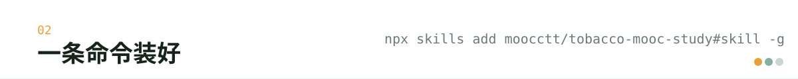
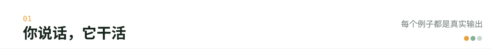
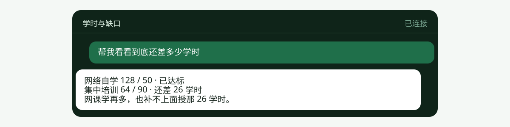
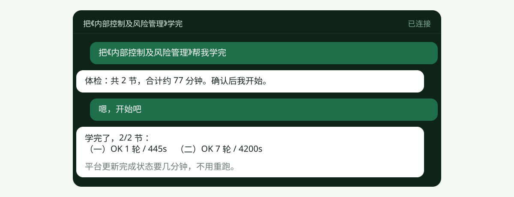
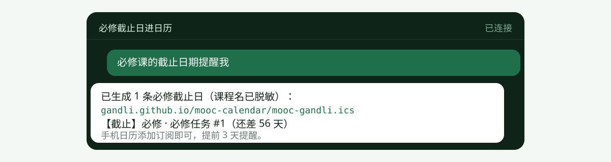
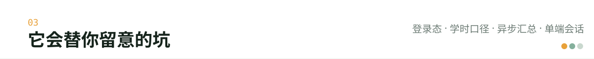
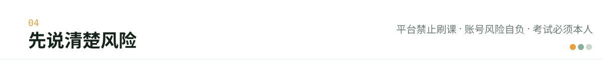

# tobacco-mooc-study (skill)

> 这个仓库按交付形态分分支：`main` 是油猴脚本（浏览器里自动播课），`cli`／`tui` 是终端版（命令行 + 全屏 TUI，同一套代码），`skill` 分支是下面这套 AI 助手技能。各分支互不依赖，装哪个都行。
>
> 给 AI 助手装的一个小插件。装好以后，你**用平常说话的方式**让它帮忙管烟草网络学院的课程——
> 看还差多少学时、安排每天学什么、把课学完、把考试截止日记到手机日历里。

不用打开网页一个个点，也不用记任何命令。

<p align="center">
  
</p>

---

## 安装

<p align="center">
  
</p>

```bash
npx skills add moocctt/tobacco-mooc-study#skill -g
```

装完就能用。第一次让它干活时，它会问你要账号（或者给你一个二维码让你扫），
再问你平时几点有空学习。

---

## 使用

<p align="center">
  
</p>

### 「帮我看看到底还差多少学时」

```
网络自学：已完成 128.00 / 要求 50.00 学时 → 超额 78.00 · 已经够了
集中培训：已完成 64.00 / 要求 90.00 学时 → 还差 26.00 · 不够
```

它还会提醒你一件事：**网课学再多也补不上面授那 26 学时**，这两样分开考核。
平台不会告诉你，但年底评的时候会卡住。

<p align="center">
  
</p>

### 「按我的上班时间，排一下下周学什么」

你告诉它你是坐班、加班季、休假还是轮班，它就按工作日晚上少排、周末多排：

```
周一晚上   《加强国有企业管理》  约 1 小时
周六       《安全生产再教育》    约 3 小时
提醒：面上培训还差 26 学时，只能报名参加
```

### 「把《内部控制及风险管理》帮我学完」

它先告诉你这门课有几节、各剩多长时间，你点头之后它才开始。
学完会说清楚结果：

```
两节都学完了（小节完成度 2/2）
不过平台还没更新完成状态，大概要等几分钟到十几分钟，不影响你已经学到的学时
```

<p align="center">
  
</p>

### 「今天该学多少？”

它记得你今天已经学了多少，只给你剩下的额度，不会一次把一天的量刷爆。

### 「必修课的截止日期提醒我」

它会把必修课的截止日做成日历，放到你自己的一个网页地址上，你在手机日历里"订阅"一下，
之后到期前 3 天手机会自动提醒你。

<p align="center">
  
</p>

### 「生成今年的学习报告」

出一份能翻页的网页：今年学了多少、哪几个月偷懒了、必修课完成多少、培训班明细。

---

## 它会替你留意的事

<p align="center">
  
</p>

- **账号会不会失效**：过期了会提醒你重新登录，不会拿着过期的账号干半天白活。
- **学完为什么没显示完成**：平台的完成状态是慢慢更新的，它知道这个延迟，会如实告诉你"等一会儿"，不会让你重学一遍。
- **会不会重复学**：已经学过的课不会再动，省得白扣学习时长。
- **手机和电脑打架**：同一个账号手机登了会把电脑这边顶下去，它会提前提醒你。
- **考试和作业**：它不碰，会告诉你"这个得你自己做"。
- **课程名字外泄**：公开的日历里只写"必修任务 #1"，不写你学的是什么课。

---

## 常见问题

**要花钱吗？**
不用，这是开源的个人工具。

**密码会被看到吗？**
不会。密码直接存到你电脑本地（加密），不进聊天记录，也不会写进它给你的文件里。
不想存也行，让它每次给你二维码扫。

**会不会把我手机上的 App 顶下线？**
会。同一个账号只能在一个地方登录。你手机在学的时候，电脑这边会被顶掉，反过来也一样。
所以要么用手机，要么让它在电脑上学，别同时开着。

**学完为什么还显示没完成？**
平台更新得慢，等一会儿就好。它会在结果里写清楚"还在等平台更新"，这不是失败。

**能管几个账号？**
可以多个，各管各的。

---

想了解它是怎么实现的（接口、字段、日志格式这些），看 [SKILL.md](SKILL.md)。

---

## 边界

<p align="center">
  
</p>

- 烟草网络学院**明令禁止刷课**，而且有检测手段。这个插件帮你自动学，本质上是在绕过平台的
  学习时长检查。**万一被判定刷课，可能学时清零、成绩作废，甚至账号受罚。**
- 所以它**只在你明确说"帮我学完"的时候才动手**，而且只对你自己一个人账号。
  动手前会先把上面这段风险再说一遍，并给你一份"打算学哪些、各多久"的清单，你确认了才真学。
- 考试、作业、调研这类必须本人做的，它一律不碰。

---

## 免责声明

本项目仅用于**本人账号**的学习进度管理，不得用于代刷、售卖或任何商业用途。
平台规则随时可能收紧，使用产生的一切后果由使用者自负。
