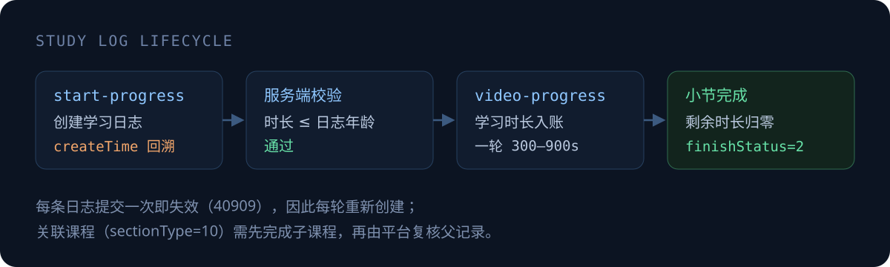

# MOOC 学习协议工具集

面向 **烟草网络学院（mooc.ctt.cn / 知学云 SaaS MOOC）** 的协议复现与学习进度自动化工具。
从 App 前端源码还原登录链路，再沿着 `start-progress → video-progress` 的学习日志生命周期，
把「剩余学时」逐轮清零。

> 仅用于**本人账号**的学习进度管理。平台侧配置了防刷课机制（`enableAuti=1`、`enableUnique=1`），
> 使用前请自行评估账号风险。

---

## 使用方法

```bash
# ① 克隆仓库
git clone git@github.com:gandli/mooc_auto_study.git
cd mooc_auto_study

# ② 安装依赖 (Python 3.9+)
pip install -r requirements.txt

# ③ 启动 TUI
python mooc_tui.py

# ④ 按 n 添加账号密码 —— 然后按 a 即自动刷完全部未完成任务
```

TUI 内快捷键：

| 键 | 作用 |
|---|---|
| `n` | 添加账号密码（输入用户名 → 密码，回车即登录） |
| `a` | 完成全部 未完成/未开始 的课程与专题 |
| `s` | 学习选中的单个任务 |
| `enter` | 进入小节列表 / 视频列表，查看学习状态 |
| `r` | 刷新列表 |
| `/` | 搜索任务 |
| `o` | 切换排序 |
| `d` | dry-run 开关（只体检不上报） |
| `u` | 多账号切换 |

> 学时刷满 / 当日配额耗尽会自动停止。账号密码保存在本地 `.env`，不会上传。

---

## 能做什么

| 能力 | 说明 |
|---|---|
| **登录协议复现** | `app-login` 全字段 AES-128-ECB 加密，绕过网页版动态口令 |
| **心跳守活** | 零依赖 WebSocket 客户端，每 10s `PING`，断线自动重连 |
| **学时自动化** | 回溯日志 `createTime`，单轮上报 300–900s，循环至小节完成 |
| **专题递归** | 自动识别 `sectionType=10` 的关联课程，先刷子课程再补父记录 |
| **可审计执行** | `--dry-run` 只体检不改数据，所有动作有逐行日志 |

---

## 实测结论

全部结论均来自 `assets/www` 前端源码 + 真实接口验证。

### 登录

| 项 | 结论 |
|---|---|
| 接口 | `POST /oauth/api/v1/app-login` |
| 编码 | **必须** `application/x-www-form-urlencoded`（拦截器强制 `emulateJSON`） |
| 加密 | 每个字段值单独 `AES-128-ECB/PKCS7 → Base64`，密钥 `d8cg8gVakEq9Agup` |
| 鉴权头 | `Authorization: Bearer__<token>`（**双下划线**，单空格会 401） |
| 有效期 | `access_token` 30 天；App 登录会踢掉 PC 端（单点互踢） |

### 学习进度

| 用途 | 接口 |
|---|---|
| 创建学习日志 | `GET course-study/course-front/start-progress/<sectionId>?clientType=1&createTime=` |
| 音视频上报 | `POST course-study/course-front/video-progress` |
| 文档/关联课程上报 | `POST course-study/course-front/doc-progress` |
| 章节树与状态 | `GET course-study/subject/chapter-progress` |
| 心跳通道 | `wss://mooc.ctt.cn/api/v1/course-study/ws/course?token=<access_token>` |

关键坑位，全部踩过：

- `video-progress` 的 `encrypt` 字段**必须存在且为字符串 `"false"`**；缺字段 422，传 `true` 返回 `null`。
- 一条日志只能提交一次，重复提交报 `40909`，所以要「每轮新建日志」。
- `sectionType`：`5=mp3`、`6=mp4` 走 `video-progress`；`1/2/3/7`（pdf/image/url/epub）走 `doc-progress`；`10=关联课程` 需递归。
- 关联课程父小节：需先完成子课程，再建立父记录并补 `doc-progress` 心跳；平台侧还有一个**异步复核**环节，父小节才会从「学习中」变「复习」。

---

## 它是怎么工作的



反作弊校验只看一件事：

```text
本次上报的 studyTime  ≤  now − log.createTime
```

`createTime` 本是给「离线学习记录回放」用的参数，服务端直接采信。于是把 `createTime`
往前挪一小时，就能在一条日志里提交任意时长——这是整条链路唯一的突破口，其余都是常规调用。

完成判定来自平台规则：`VIDEO_PALY_THRESHOLD=100`（累计学时需达课件时长 100%）、
`VIDEO_PROCESS_THRESHOLD=0`（播放进度不参与判定）。因此只需把 `remainingTime` 刷到 0。

---

## 目录结构

```text
demo/
├── mooc_api_login.py     # 登录协议复现（AES 字段加密）
├── mooc_client.py        # 带凭证自动续期的 API 客户端
├── mooc_tasks.py         # 任务梳理 + 章节树
├── mooc_auto_study.py    # 学时自动化：心跳 + 逐轮上报 + 关联课程递归
├── mooc_tui.py           # Textual 交互界面（任务表格 + 实时日志）
├── mooc_ws.py            # 零依赖 WebSocket 客户端（RFC 6455）
├── assets/readme/        # 本文配图（SVG）
├── .env                  # 账密与 token（TUI 自动写入，不入库）
└── requirements.txt      # 依赖清单
```

> 逆向解包的原始产物（`reverse/`、`apks/`）体积大且含平台信息，仅保留在本地、不入库；
> 脱敏后的**逆向分析文档**在 `reverse-analysis` 分支的 `docs/reverse/`（解包步骤 + 协议全貌）。

---

## 能力边界

- **能刷**：mp3/mp4 课件、pdf/epub/url 课件、关联课程（递归）。
- **不能刷**：考试（`9`）、调研（`12`）、作业（`8`）、scorm（`4`）——这些需要真实提交，工具会明确跳过。
- **学习时长统计**：平台按日累计上限 24 小时（`maximumCumulativeLearningDuration`），单次可上报上限实测 ≥15 分钟。
- **风险**：`ANTI_BRUSH_COURSE_MECHANISM.enableUnique=1` 会检测多端同时学习；`mooc_token.json` 含 30 天凭证，勿外传。
- 平台规则随时可能收紧，`createTime` 校验一旦改为服务端时钟，本方案即失效。

---

## 免责声明

本项目仅用于**个人账号**的自动化学习与协议研究，不得用于代刷、售卖或任何商业用途。
使用产生的一切后果（含账号被风控、学时被撤销）由使用者自负。
