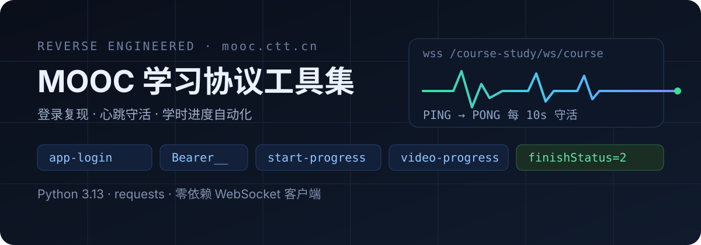
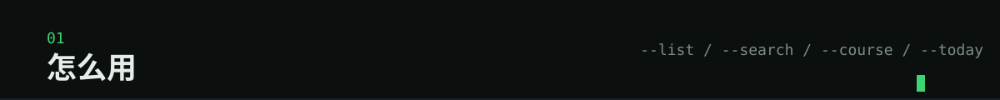
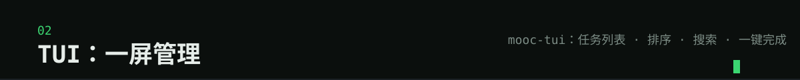
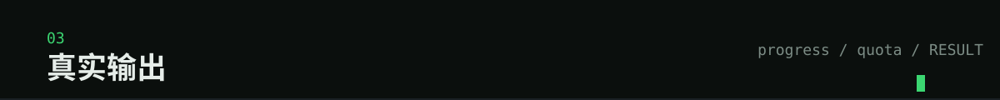

# tobacco-mooc-study (tui)

> 终端里算清「今天该学什么」，一条命令把课上完。纯 HTTP，不驱动浏览器。

这个仓库按交付形态分分支，互相不依赖，装哪个都行：`main` 油猴脚本、`web` 网页版、
`extension` 浏览器扩展、`skill` AI 助手技能、`tui`（**本分支**）终端界面版 ——
命令行 `mooc_auto_study.py` + 全屏 TUI `mooc_tui.py`。

<p align="center">
  
</p>

## 安装

```bash
pip install -r requirements.txt     # requests / rich / textual / qrcode / pillow
cp .env.example .env                # 填 MOOC_USER / MOOC_PWD（或 MOOC_LOGIN/MOOC_PASS）
python mooc_auto_study.py --list    # 看任务与学时
uv run python mooc_tui.py           # 图形界面（手机上也能用，窄屏自动精简）
```

`.env` 放在哪个目录都会读，按优先级：`TOBACCO_ENV_FILE` 指定 → `$TOBACCO_HOME/.env`
→ 当前目录 `.env` → 脚本目录 `.env`（先找到的优先，已存在的环境变量不会被覆盖）。
`.env` 已在 `.gitignore` 里，不会被提交。

多账号：`.env` 里按 `MOOC_LOGIN/MOOC_PASS` 两行一组追加，`--user <账号>` 切换。
定时跑见 [`deploy/`](./deploy)（venv + cron / Docker）。
**登录方式优先用账密**：账密走 APP 通道，token 有效期 **30 天**，过期会自动续期（只要 `.env` 里还有账密）；
扫码是兜底（网页端会话较短，且过期只能重扫）。扫码页三件事：

- 默认**正色**字符画（白块亮、黑块暗），扫码器识别率最高；浅色终端按 `i` 切反色
- 字符画受终端字体宽高比影响，扫不动就按 `o` 用系统看图程序打开 PNG，扫电脑屏幕上的图片
- 微信通道若提示「换取凭证失败」，从登录页 URL 的 `#login/<key>` 取 key，设 `MOOC_HASH_KEY` 后重试

<p align="center">
  
</p>

## 使用

| 我想… | 命令 |
| --- | --- |
| 看任务与学时 | `mooc_auto_study.py --list` |
| 学完一个课程/专题 | `mooc_auto_study.py --course <名称\|id\|URL>` |
| 搜索平台课程库（含未加入任务的） | `mooc_auto_study.py --search 消防安全` |
| 学完所有未完成 | `mooc_auto_study.py --todo` |
| 补学时到要求线 | `mooc_auto_study.py --hours auto`（或 `--hours 8`） |
| 只学今天的量 | `mooc_auto_study.py --today`（按工作档位容量扣当日已学） |
| 导出必修截止日 | `mooc_auto_study.py --ics mooc.ics` |
| 只体检不上报 | 任意命令加 `--dry-run` |

## TUI

<p align="center">
  
</p>

```bash
python mooc_tui.py
```

`n` 添加账号、`a` 完成全部、`s` 学选中、`/` 搜索、`o` 排序、`r` 刷新、`q` 退出。

<p align="center">
  
</p>

## 真实输出

```console
$ mooc_auto_study.py --list
[专题|未完成] 国有企业人工智能先进技术应用      8e930e92-8984-43b5-812b-743a02fafe0f
网络自学 133.0 / 50.0 学时 | 集中培训 64.0 学时

$ mooc_auto_study.py --search 消防安全
[搜索] 「消防安全」命中 25 条（平台课程库，含未加入任务的）
  [课程] 消防安全管理                       2.3 学时  4fd8672d-...
  [专题] 《抓消防安全 保高质量发展》2022年消防宣传月学习专题  28.8 学时  d298d0df-...
RESULT|ok=true|mode=search|found=25

$ mooc_auto_study.py --course "内部控制及风险管理"
[1/2] (mp4) 内部控制与风险管理（一）  -> OK 完成，共 1 轮 / 445s
[2/2] (mp4) 内部控制与风险管理（二）  -> OK 完成，共 7 轮 / 4200s
结果: 成功 2 / 失败 0 | 小节完成度 2/2
```

## 两种课程来源

| 来源 | 识别方式 | 学习链 |
| --- | --- | --- |
| 我的任务/我的课程 | `human/task` + `personCourse-list` | `start-progress(clientType=1)` + 明文 `video-progress` |
| **平台课程库**（`--search` 找到的） | 搜索 `findPageForGlobalSearch` | `registerStudy` 报名 → `course-front/info/<id>` 取章节 → `start-progress(clientType=0)` + **AES 加密 `video-progress`** |

语义约定（与 main/web 分支一致）：完成态 `finishStatus ∈ {2,4}`（2=复习、4=完成）、任务 `status 3=已完成`、过期看独立 `expired`。
详见 [docs/features.md](docs/features.md)。

## 开发与测试

```bash
pip install -r requirements-dev.txt
python -m pytest tests -q
```

CI：`.github/workflows/tests.yml`（push 到 main/tui 触发 pytest + 覆盖率）。

---

## 边界

平台页脚明确「禁止刷课」，并配置防刷机制（`enableAuti`、`enableUnique` 多端检测、单日 24 小时上限）。
本工具复现的是学习日志上报接口（`start-progress` 的 `createTime` 回溯 + 逐轮上报），等于绕过时长校验——
**账号风险自负**：被判定刷课可能导致学时清零、成绩作废或账号处罚。仅用于本人账号。

考试、作业、调研需本人完成，脚本只跳过。

## 免责声明

本项目仅用于**本人账号**的学习进度管理，不得用于代刷、售卖或任何商业用途。
平台规则随时可能收紧，使用产生的一切后果由使用者自负。
